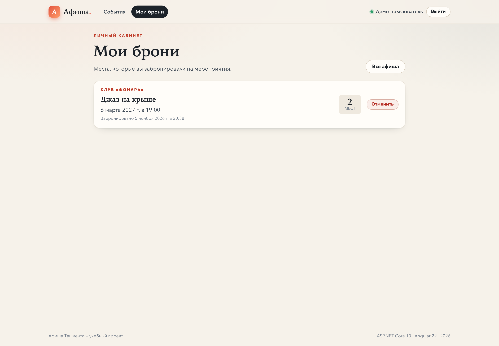

# Афиша мероприятий

**Вариант № 8 — «Афиша мероприятий»**
Учебный проект: ASP.NET Core 10 Web API + Angular 22 + EF Core/SQLite.

Пользователь видит афишу, фильтрует её по площадке, бесплатности и дате,
сортирует по дате или цене, листает страницы и **бронирует места** под своим
аккаунтом. Управлять афишей — создавать, редактировать, удалять мероприятия и
загружать постеры — может **только администратор**. Запись блокируется за 24 часа
до начала.

📖 **Построчный разбор кода для защиты:** [docs/code/README.md](docs/code/README.md)

---

## Структура проекта

```
afisha/
├── backend/                        # БЭКЕНД: ASP.NET Core Web API
│   ├── Afisha.slnx
│   └── Afisha.Api/
│       ├── Program.cs              # запуск: DI, JWT, роли, middleware
│       ├── Endpoints/              # /api/events, /api/auth, /api/venues
│       ├── Data/                   # DbContext, начальные данные
│       ├── Models/                 # Event, Venue, User (с полем Role)
│       ├── Contracts/              # DTO-записи для ответов API
│       ├── Validation/             # FluentValidation + ProblemDetails
│       ├── Auth/                   # PBKDF2-хеш и выпуск JWT
│       ├── Storage/                # сохранение постеров
│       ├── Migrations/             # 3 миграции EF Core
│       └── wwwroot/uploads/        # загруженные постеры (в git не входят)
│
├── frontend/                       # ФРОНТЕНД: Angular 22
│   ├── src/app/
│   │   ├── pages/                  # список, событие, форма, вход, регистрация, 404
│   │   ├── components/             # карточка, список, фильтр
│   │   ├── core/                   # сервисы, модели, guard, interceptor
│   │   ├── app.routes.ts           # маршруты
│   │   ├── app.config.ts           # провайдеры приложения
│   │   └── app.html                # шапка и подвал
│   ├── proxy.conf.json             # /api → localhost:5055
│   └── package.json
│
├── database/                       # БАЗА ДАННЫХ: сюда создаётся afisha.db
│   └── .gitkeep                    # сам файл базы в git не входит
│
├── docs/                           # документация и скриншоты
│   ├── code/                       # построчный разбор кода
│   ├── screenshots/                # 4 скриншота для README
│   └── sample-poster.png           # файл для загрузки из .http
│
├── scripts/                        # вспомогательные скрипты
│   └── setup-secrets.sh            # генерация Jwt:Key в user-secrets
│
├── afisha.http                     # запросы ко всем endpoint'ам
└── README.md
```

**Коротко:** `backend` — сервер и API, `frontend` — сайт в браузере,
`database` — файл SQLite, `docs` — документация, `scripts` — запуск/секреты.

---

## Роли

| Роль | Логин | Пароль | Что может |
| --- | --- | --- | --- |
| **Администратор** | `admin` | `admin` | смотреть, бронировать, создавать, редактировать, удалять, загружать постер |
| Обычный пользователь | `demo@afisha.local` | `Demo12345` | смотреть афишу и бронировать места |
| Второй пользователь | `guest@afisha.local` | `Guest12345` | только смотреть (для проверки 403) |

Администратор создаётся автоматически при старте сервера, если в базе ещё нет
пользователя с ролью `Admin`. Пароль хранится PBKDF2-хешем — как у всех.

Правила:

- неавторизованный `POST/PUT/DELETE` и загрузка постера → **401**;
- авторизованный обычный пользователь → **403**;
- администратор → операция выполняется (200/201/204);
- если до начала меньше 24 часов — **400** даже для администратора.

Кнопки «Добавить», «Редактировать», «Удалить», «Загрузить постер» показываются
только администратору. Сервер проверяет роль повторно — клиенту доверять нельзя.

---

## Бронирование мест

Любой вошедший пользователь может занять места на будущее мероприятие:

- на странице события есть блок «Занять места» с количеством свободных мест;
- можно забронировать от 1 до 50 мест, но не больше, чем осталось;
- одна активная бронь на пользователя и событие (повторная — 400, сначала отмените);
- свою бронь можно отменить на странице события или в разделе **«Мои брони»**;
- бронировать прошедшее событие нельзя (400);
- администратор не может уменьшить общее число мест ниже уже забронированных;
- при удалении события его брони удаляются автоматически (FK Cascade).

Свободные места = `Events.Seats − сумма Reservations.Seats` и показываются в
карточке и на странице события.

---

## Быстрый старт

### 1. Сервер

Требуется .NET 10 SDK.

```bash
cd backend/Afisha.Api

# Ключ подписи JWT хранится только в user-secrets (в git его нет).
# Из корня репозитория можно выполнить:
#   bash scripts/setup-secrets.sh
# или вручную:
dotnet user-secrets set "Jwt:Key" "$(openssl rand -base64 48)"

dotnet run --launch-profile http
```

Сервер: <http://localhost:5055>

- Scalar (все методы API): <http://localhost:5055/scalar>
- OpenAPI JSON: <http://localhost:5055/openapi/v1.json>

При старте EF Core применяет миграции и создаёт `database/afisha.db`.
Начальные данные: 5 площадок, 2 пользователя, 8 мероприятий. Администратор
`admin/admin` добавляется автоматически, если его ещё нет.

Пересоздать базу: остановить сервер, удалить `database/afisha.db`, запустить снова.

Ручное применение миграций (необязательно):

```bash
cd backend/Afisha.Api
dotnet tool restore
dotnet ef database update
```

### 2. Клиент

Требуется Node.js 22+.

```bash
cd frontend
npm install
npm start
```

Клиент: <http://localhost:4200>. Запросы к `/api` и `/uploads` проксируются
на `http://localhost:5055` (см. `frontend/proxy.conf.json`).

---

## API

Базовый адрес: `http://localhost:5055`.

| Метод | Адрес | Доступ | Коды |
| --- | --- | --- | --- |
| GET | `/api/events` | любой | 200, 400 |
| GET | `/api/events/{id}` | любой | 200, 404 |
| POST | `/api/events` | **только Admin** | 201, 400, 401, 403 |
| PUT | `/api/events/{id}` | **только Admin** | 200, 400, 401, 403, 404 |
| DELETE | `/api/events/{id}` | **только Admin** | 204, 400, 401, 403, 404 |
| POST | `/api/events/{id}/poster` | **только Admin** | 200, 400, 401, 403, 404 |
| POST | `/api/events/{id}/reservations` | вошедший | 201, 400, 401, 404 |
| GET | `/api/reservations/my` | вошедший | 200, 401 |
| DELETE | `/api/reservations/{id}` | автор брони | 204, 401, 403, 404 |
| GET | `/api/venues` | любой | 200 |
| POST | `/api/auth/register` | любой | 201, 400 |
| POST | `/api/auth/login` | любой | 200, 400, 401 |
| GET | `/api/auth/me` | вошедший | 200, 401, 404 |

### Список: страницы, фильтры, сортировка

`GET /api/events?page=1&pageSize=6&venueId=2&free=true&date=2027-02-14&sort=price&order=desc`

| Параметр | Значение |
| --- | --- |
| `page` | номер страницы, от 1 |
| `pageSize` | размер страницы, 1–50 |
| `venueId` | id площадки (фильтр) |
| `free` | `true` — только бесплатные, `false` — только платные |
| `date` | календарный день начала в UTC, `YYYY-MM-DD` |
| `sort` | `date` или `price` |
| `order` | `asc` или `desc` |

Ответ содержит `items`, `page`, `pageSize`, `total`, `totalPages`.

### Правила

- **Создание** — только администратор; дата начала строго в будущем.
- **Бронирование** — только вошедший, до начала события; сумма броней не больше
  общего числа мест; одна активная бронь на пользователя и событие.
- **Роль** — `role` берётся из JWT (`Admin`/`User`), изменить её в теле запроса нельзя.
- **24 часа** — если до начала меньше суток, `PUT`, `DELETE` и загрузка постера
  возвращают `400` с ProblemDetails.
- **Постер** — один файл, до 5 МБ, jpg/jpeg/png/webp, проверяются расширение,
  MIME-тип и сигнатура; на диске имя `{guid}.{ext}`.
- **Ошибки валидации** — `400` в формате ProblemDetails с объектом `errors`.

Пример ProblemDetails:

```json
{
  "type": "https://tools.ietf.org/html/rfc9110#section-15.5.1",
  "title": "One or more validation errors occurred.",
  "status": 400,
  "errors": {
    "title": ["Название обязательно."],
    "startsAt": ["Дата начала должна быть в будущем."]
  }
}
```

### Проверка отказов

- `401` — `POST /api/events` без заголовка `Authorization`.
- `403` — войти как `demo@afisha.local` и попробовать создать/изменить/удалить.
- `404` — `GET /api/events/99999`.
- `400` — пустое название, цена `-5`, дата в прошлом, площадка `999`.
- `24 часа` — создать мероприятие на ближайшие 2 часа, затем `PUT`/`DELETE`.

Все примеры есть в файле [`afisha.http`](afisha.http) (VS Code REST Client).

---

## Клиент

- **Маршруты:** `/events`, `/events/:id`, `/events/new`, `/events/:id/edit`,
  `/login`, `/register`, `/404` и `**` → 404.
- **Доступ:** `/events/new` и `/events/:id/edit` защищены `adminGuard` —
  обычного пользователя перекинет на `/events`.
- **Компоненты:** карточка, список, фильтр — на `input()`/`output()` и сигналах.
- **Сервис:** `EventService` (`inject(HttpClient)`), чтение через `httpResource`,
  запись — через `HttpClient`.
- **Состояния:** загрузка (скелетоны), ошибка (кнопка «Повторить»), пусто
  (подсказка и сброс фильтров) и данные.
- **Интерсептор** добавляет JWT к каждому запросу.
- **Валидация формы** повторяет серверную; ошибки сервера выводятся под полем.
- **Кнопки управления** видны только администратору.

---

## Скриншоты

### Список с фильтрами и постраничной навигацией


### Страница мероприятия


### Форма с ошибками валидации


### Загруженный постер


### Мои брони



---

## База данных

SQLite-файл `database/afisha.db`, создаётся автоматически. Таблицы:

- `Venues` (справочник) 1 → N `Events`;
- `Users` — пользователи и их роль (`Admin`/`User`);
- `Events` — главная сущность, `AuthorId` указывает на создателя;
- `Reservations` — брони: `EventId`, `UserId`, `Seats`, уникальная пара
  (`EventId`, `UserId`), каскадное удаление вместе с событием.

Начальные данные (`HasData`): 5 площадок, 2 пользователя, 8 мероприятий.
Администратор добавляется при старте, чтобы не конфликтовать с Id реальных
пользователей в существующей базе.

Миграции:

1. `InitialCreate` — схема и начальные данные;
2. `AddEventCreatedAtIndex` — индекс по `CreatedAt`;
3. `AddUserRoles` — колонка `Role` у пользователей;
4. `AddReservations` — таблица броней и уникальный индекс.

Файл базы в `.gitignore` и в репозиторий не попадает.

---

## Примечания

- Даты хранятся в UTC, клиент показывает их в часовом поясе браузера.
- Ключ JWT читается из user-secrets; в `appsettings.json` только Issuer/Audience.
- Scalar: `/scalar`, OpenAPI: `/openapi/v1.json`.
- Для загрузки постера из `afisha.http` используется `docs/sample-poster.png`.
- Пароль администратора `admin/admin` — учебный; в реальном проекте так нельзя.
