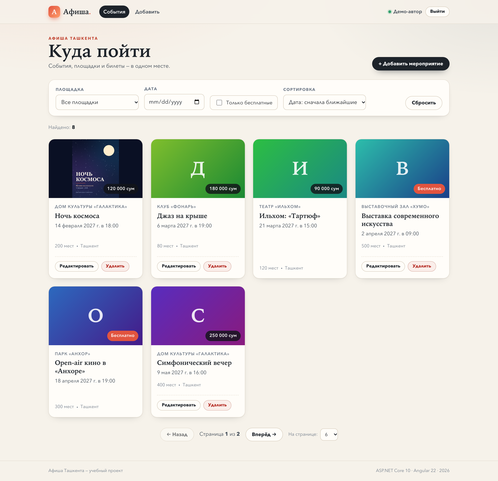
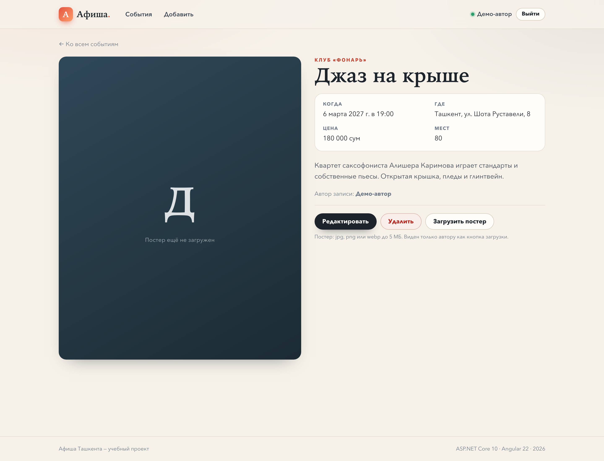
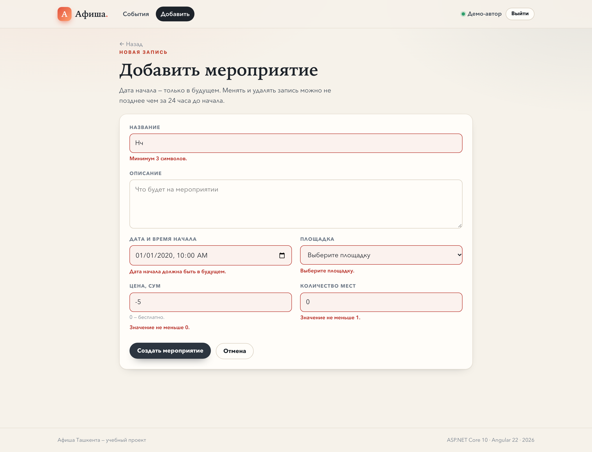
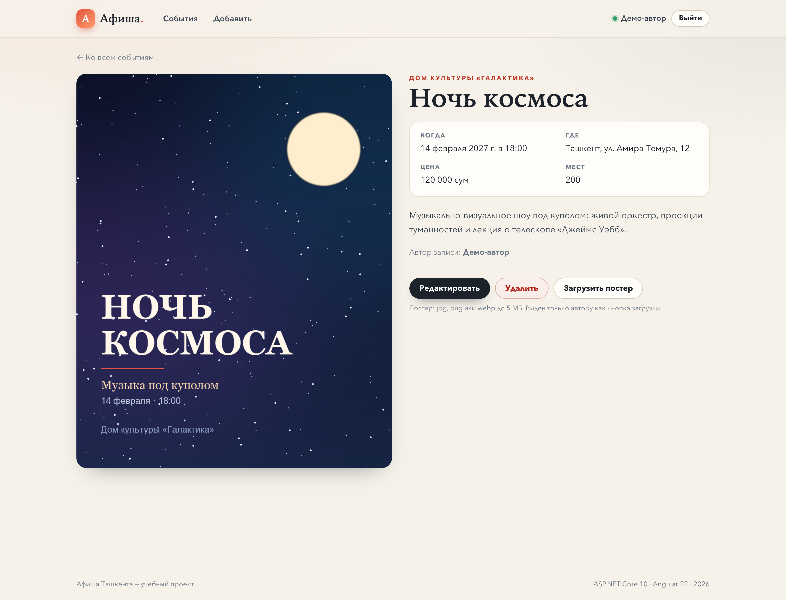

# Афиша мероприятий

**Вариант № 8 — «Афиша мероприятий»**
Учебный проект: ASP.NET Core 10 Web API + Angular 22 + EF Core/SQLite.

Пользователь видит афишу событий, фильтрует её по площадке, бесплатности и дате,
сортирует по дате или цене, листает страницы. Вошедший пользователь создаёт мероприятия,
а менять/удалять их и загружать постер может только автор. Запись блокируется
за 24 часа до начала.

---

## Стек

| Слой | Технологии |
| --- | --- |
| Сервер | .NET 10, ASP.NET Core Minimal API, EF Core 10, SQLite, FluentValidation, JWT Bearer, Scalar (OpenAPI) |
| Клиент | Angular 22 (standalone, signals, `input()`/`output()`), `httpResource`, reactive forms, функциональные интерсептор и guard |
| Файлы | постеры в `wwwroot/uploads/posters`, имя — GUID, до 5 МБ, jpg/png/webp |

---

## Быстрый старт

### 1. Сервер

Требуется .NET 10 SDK.

```bash
cd server/Afisha.Api

# Ключ подписи JWT хранится только в user-secrets (в git его нет).
# Можно выполнить скрипт из корня репозитория:
#   bash scripts/setup-secrets.sh
# или вручную:
dotnet user-secrets set "Jwt:Key" "$(openssl rand -base64 48)"

dotnet run --launch-profile http
```

Сервер: <http://localhost:5055>

- Scalar (все методы API): <http://localhost:5055/scalar>
- OpenAPI JSON: <http://localhost:5055/openapi/v1.json>

Миграции применяются автоматически при старте, база `afisha.db` создаётся рядом с проектом.
Чтобы пересоздать базу с начальными данными — удалите `afisha.db` и запустите сервер снова.

Ручное применение миграций (необязательно):

```bash
dotnet tool restore
dotnet ef database update
```

### 2. Клиент

Требуется Node.js 22+.

```bash
cd client
npm install
npm start
```

Клиент: <http://localhost:4200>. Запросы к `/api` и `/uploads` проксируются
на `http://localhost:5055` (см. `client/proxy.conf.json`).

### Тестовые пользователи

| Email | Пароль | Роль |
| --- | --- | --- |
| `demo@afisha.local` | `Demo12345` | автор своих мероприятий |
| `guest@afisha.local` | `Guest12345` | второй автор — удобно проверять 403 |

Оба пользователя есть в начальных данных (`HasData`). Пароли хранятся только
PBKDF2-хешем (100 000 итераций, SHA-256, соль 16 байт).

---

## API

Базовый адрес: `http://localhost:5055`.

| Метод | Адрес | Доступ | Коды |
| --- | --- | --- | --- |
| GET | `/api/events` | любой | 200, 400 |
| GET | `/api/events/{id}` | любой | 200, 404 |
| POST | `/api/events` | вошедший | 201, 400, 401 |
| PUT | `/api/events/{id}` | только автор | 200, 400, 401, 403, 404 |
| DELETE | `/api/events/{id}` | только автор | 204, 400, 401, 403, 404 |
| POST | `/api/events/{id}/poster` | только автор | 200, 400, 401, 403, 404 |
| GET | `/api/venues` | любой | 200 |
| POST | `/api/auth/register` | любой | 201, 400 |
| POST | `/api/auth/login` | любой | 200, 400, 401 |
| GET | `/api/auth/me` | вошедший | 200, 401, 404 |

### Список: страницы, фильтры, сортировка

`GET /api/events?page=1&pageSize=6&venueId=2&free=true&date=2027-02-14&sort=price&order=desc`

| Параметр | Значение |
| --- | --- |
| `page` | номер страницы, от 1 |
| `pageSize` | размер страницы, 1–50 |
| `venueId` | id площадки (фильтр) |
| `free` | `true` — только бесплатные, `false` — только платные |
| `date` | календарный день начала в UTC, `YYYY-MM-DD` |
| `sort` | `date` или `price` |
| `order` | `asc` или `desc` |

Ответ содержит `items`, `page`, `pageSize`, `total`, `totalPages`.

### Правила

- **Создание** — дата начала строго в будущем (проверяется на сервере и в форме).
- **Автор** — `authorId` берётся из JWT, подменить его в теле запроса нельзя.
- **24 часа** — если до начала меньше суток, `PUT`, `DELETE` и загрузка постера
  возвращают `400` с ProblemDetails «До начала осталось меньше 24 часов».
- **Постер** — один файл, до 5 МБ, jpg/jpeg/png/webp, проверяются расширение,
  MIME-тип и сигнатура файла; на диске имя `{guid}.{ext}`.
- **Ошибки валидации** — `400` в формате ProblemDetails с объектом `errors`
  (ключи — camelCase, как поля формы на клиенте).

Пример ProblemDetails:

```json
{
  "type": "https://tools.ietf.org/html/rfc9110#section-15.5.1",
  "title": "One or more validation errors occurred.",
  "status": 400,
  "errors": {
    "title": ["Название обязательно."],
    "startsAt": ["Дата начала должна быть в будущем."]
  }
}
```

### Проверка отказов

- `401` — POST/PUT/DELETE без заголовка `Authorization: Bearer <token>`.
- `403` — войти под `guest@afisha.local` и попробовать изменить мероприятие,
  созданное `demo@afisha.local`.
- `404` — `GET /api/events/99999`.
- `400` — пустое название, цена `-5`, дата в прошлом, площадка `999`.
- `24 часа` — создать мероприятие на ближайшие 2 часа, затем попробовать `PUT`/`DELETE`.

Все примеры есть в файле [`afisha.http`](afisha.http) (VS Code REST Client /
JetBrains HTTP Client).

---

## Клиент

- **Маршруты:** `/events` (список), `/events/:id` (страница записи), `/events/new`,
  `/events/:id/edit` (под guard), `/login`, `/register`, `/404` и `**` → 404.
- **Компоненты:** карточка (`app-event-card`), список (`app-event-list`),
  фильтр (`app-event-filter`) — на `input()`/`output()` и сигналах.
- **Сервис:** `EventService` (`inject(HttpClient)`), чтение через `httpResource`,
  запись — через `HttpClient`.
- **Состояния экрана:** загрузка (скелетоны), ошибка (с кнопкой «Повторить»),
  пусто (с подсказкой и сбросом фильтров) и данные.
- **Интерсептор** добавляет JWT к каждому запросу.
- **Guard** не пускает на формы без входа и возвращает на форму после логина.
- **Авторские действия** («Редактировать», «Удалить», «Загрузить постер»)
  показываются только автору записи; сервер проверяет это повторно.
- **Валидация формы** повторяет серверную: название 3–200, описание ≤ 2000,
  дата в будущем, цена 0–1 000 000, мест 1–50 000, площадка обязательна.
  Ошибки сервера выводятся под соответствующим полем.

---

## Скриншоты

### Список с фильтрами и постраничной навигацией



### Страница мероприятия



### Форма с ошибками валидации



### Загруженный постер



---

## Структура репозитория

```
afisha/
├── afisha.http                  # запросы ко всем endpoint'ам
├── README.md
├── scripts/setup-secrets.sh     # генерация Jwt:Key в user-secrets
├── docs/
│   ├── sample-poster.png        # файл для загрузки из .http
│   └── screenshots/             # 4 скриншота для README
├── server/
│   ├── Afisha.sln
│   └── Afisha.Api/
│       ├── Program.cs
│       ├── Auth/                # PBKDF2, JWT
│       ├── Contracts/           # DTO-записи (record)
│       ├── Data/                # DbContext, SeedData, HasData
│       ├── Endpoints/           # events, venues, auth
│       ├── Migrations/          # InitialCreate + AddEventCreatedAtIndex
│       ├── Models/              # Event, Venue, User
│       ├── Storage/             # PosterStorage (Guid, 5 МБ, jpg/png/webp)
│       ├── Validation/          # FluentValidation + ProblemDetails
│       └── wwwroot/uploads/     # загруженные постеры (в git не попадают)
└── client/
    └── src/app/
        ├── components/          # карточка, список, фильтр
        ├── core/                # сервисы, интерсептор, guard, модели
        └── pages/               # список, запись, форма, вход, регистрация, 404
```

---

## База данных

Две основные таблицы связаны «один-ко-многим»:

- `Venues` (справочник) 1 → N `Events`;
- `Events` → `Users` (автор, тоже связь many-to-one);
- `Users` нужны для входа и проверки авторства.

Начальные данные (`HasData`): 5 площадок, 2 пользователя, 8 мероприятий
(в том числе бесплатные). Даты — 2027 год, чтобы события оставались в будущем.

Миграции:

1. `InitialCreate` — схема и начальные данные;
2. `AddEventCreatedAtIndex` — индекс по `CreatedAt`.

Файл базы `afisha.db` в `.gitignore` и в репозиторий не попадает.

---

## Примечания

- Даты на сервере хранятся в UTC, клиент показывает их в часовом поясе браузера.
  Фильтр `date` трактует дату как UTC-день.
- Ключ JWT читается из user-secrets; в `appsettings.json` лежат только
  `Jwt:Issuer`, `Jwt:Audience` и время жизни токена.
- Scalar открывается по адресу `/scalar`, OpenAPI — `/openapi/v1.json`.
- Для загрузки постера из `afisha.http` используется `docs/sample-poster.png`.
